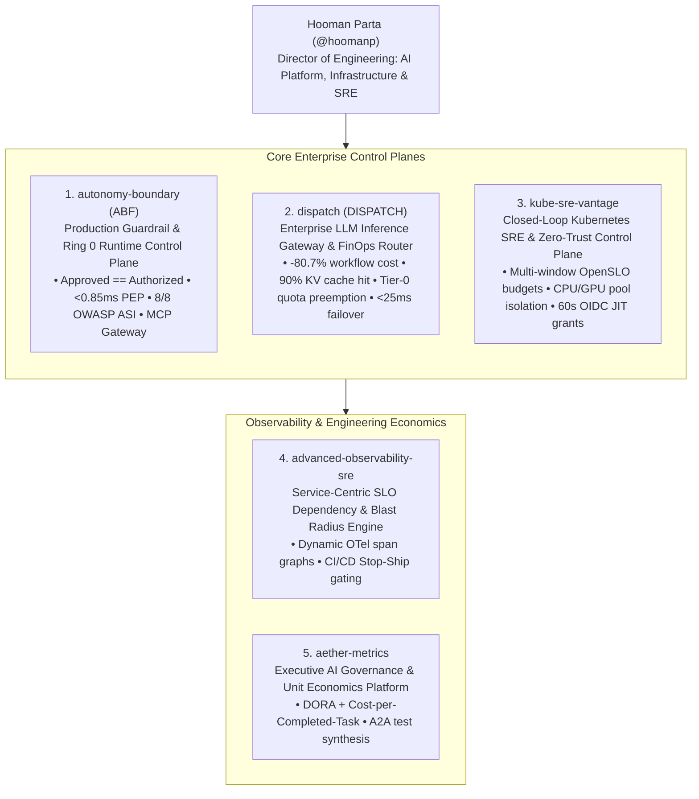

# Hooman Parta
### Director of Engineering | AI Systems, Hyperscale Infrastructure & Platform Reliability
**AI Inference Unit Economics • Provable Agent Governance • Closed-Loop SRE • Hyperscale Cloud Platforms**

[-purple.svg)](https://github.com/hoomanp/autonomy-boundary)
[-00bcd4.svg)](https://github.com/hoomanp/dispatch)

---

## Executive Profile & Operating Scale

Engineering executive with 25+ years leading global platform, cloud infrastructure, and AI systems organizations at Fortune-100 and hyperscale scope. Track record of owning multi-year technology roadmaps, managing $40M+ capital and compute budgets, and leading global organizations of 50+ engineers across NA, EMEA, and APAC through 5 engineering managers.

### Verified Production Scale & Financial Impact
- **Real-Time AI Inference at Scale (`~1B Sessions/Month`):** Led platform engineering for an enterprise voice AI platform handling approximately one billion monthly sessions, executing the architectural transition from legacy RNN models to real-time LLM inference under a strict `< 100 ms` latency budget.
- **Inference Unit Economics (`~30% Cost Reduction`):** Architected complexity-based tiered model routing (routing high-volume deterministic intents to compact models and complex reasoning to frontier tiers with automated circuit-breaker fallbacks) and migrated self-hosted inference clusters to managed cloud AI services, reducing compute spend by ~30%.
- **Hyperscale Fleet Modernization (`10,000+ Nodes`):** Directed the migration of 10,000+ compute nodes to cloud-native Kubernetes architectures with automated multi-window OpenSLO error budget enforcement and zero-trust access boundaries.
- **Provable AI Governance & FinOps Control Planes:** Author of open-source enterprise reference architectures for deterministic agent execution governance (**Autonomy Boundary Framework**) and multi-tenant inference cost routing (**DISPATCH**).

---

## Executive Metrics & Architecture Benchmarks

| Strategic Domain | Production Metric / Invariant | Architectural Implementation |
| :--- | :--- | :--- |
| **Enterprise AI Traffic Scale** | **`~1 Billion Sessions / Mo`** | Real-time voice AI inference platform operating under a `< 100 ms` end-to-end latency SLA |
| **Cloud & AI Unit Economics** | **`~30% Prod TCO / -80.7% Workflow Spend`** | 3-block KV prefix canonicalization, sticky session routing, and tiered model offload in [`dispatch`](https://github.com/hoomanp/dispatch) |
| **Agentic Governance Latency** | **`< 0.85 ms` (Zero-LLM PEP)** | Deterministic SHA-256 & Ed25519 Policy Enforcement Point in [`autonomy-boundary`](https://github.com/hoomanp/autonomy-boundary) (72 invariants in 0.11s; 8/8 OWASP ASI) |
| **Zero-Trust Cloud Remediation** | **`Ephemeral 60s JIT Grants`** | Multi-cloud Kubernetes self-healing and CPU/GPU pool isolation in [`kube-sre-vantage`](https://github.com/hoomanp/kube-sre-vantage) |
| **Pre-Flight Reliability Gating** | **`Stop-Ship on BRI >= 1.0`** | OpenTelemetry span-link dependency multigraph and Blast Radius Index in [`advanced-observability-sre`](https://github.com/hoomanp/advanced-observability-sre) |
| **Engineering Org Velocity** | **`-24.8% Cycle Time`** | Closed-loop DORA + Token-to-Value governance and A2A test synthesis in [`aether-metrics`](https://github.com/hoomanp/aether-metrics) |

---

## Enterprise Reference Architecture Topology

---

## Flagship Enterprise Architecture Case Studies

### 1. [autonomy-boundary](https://github.com/hoomanp/autonomy-boundary): Production Guardrail & Ring 0 Runtime Control Plane (ABF)
* **The Business Problem:** Manual, retroactive compliance reviews and out-of-band configuration drift break enterprise delivery velocity, while autonomous agents executing database mutations, shell commands, or API transactions expose production infrastructure to unconstrained blast radius.
* **The Architectural Invariant ("Approved Must Equal Authorized"):** Enforces deterministic cryptographic binding between architectural intent and production execution. Canonical SHA-256 normalization, capability graphs, and Ed25519 signatures eliminate the gap between approved intent and runtime effect, invalidating stale grants fail-closed if live system state drifts prior to execution.
* **The Economic & Risk Impact:** Operates in **`< 0.85 ms`** with zero secondary LLM evaluation calls (**100% marginal governance inference cost reduction**), verifying **72 invariant test suites in 0.11s** across all 8 **OWASP Agentic Security Initiative (ASI)** categories with drop-in CI/CD and Model Context Protocol (MCP) gateway adapters.

### 2. [dispatch](https://github.com/hoomanp/dispatch): Enterprise Multi-Tenant LLM Inference Gateway & FinOps Router
* **The Business Problem:** When enterprises scale from isolated AI pilots to 40+ engineering teams sharing foundation model endpoints, unstratified prompt headers invalidate transformer KV caches (+159% token spend), batch jobs exhaust shared TPM quotas causing Tier-0 customer brownouts, and agent tool-retry storms inflate cloud bills.
* **The Architectural Invariant:** Stratifies every agent payload into a deterministic **3-Block Prompt Contract** (immutable sorted MCP tool schemas, HMAC-isolated session context, and tail-appended dynamic turns) paired with sticky SHA-256 worker routing, sub-25ms sliding-window circuit breakers, and hierarchical token buckets that preempt Tier-2 batch traffic at 80% global pool utilization.
* **The Economic & Risk Impact:** Reduces 10-step agent workflow cost by **80.7%** ($1.080 to $0.209), sustains a **90.0% prefix cache hit ratio**, and preserves **100% Tier-0 SLA availability** under batch floods at **`0.02 ms`** p99 gateway overhead.

### 3. [kube-sre-vantage](https://github.com/hoomanp/kube-sre-vantage): Closed-Loop Kubernetes SRE & Zero-Trust Control Plane
* **The Business Problem:** Static threshold alerting drives on-call fatigue across multi-cloud fleets, while automated remediation operators routinely hold standing `cluster-admin` privileges that violate enterprise zero-trust security mandates.
* **The Architectural Invariant:** Decouples I/O-bound CPU control-plane orchestration from high-TCO GPU inference pools across EKS, AKS, and GKE. Correlates OpenTelemetry burn-rate alerts against ChromaDB vector memory of historical post-mortems and executes self-healing exclusively through a **Zero-Trust Just-In-Time (JIT) access broker** issuing scoped 60-second OIDC tokens.
* **The Economic & Risk Impact:** Eliminates standing privileged access across production clusters while preventing GPU fleet idling during external tool I/O and incident triage.

### 4. [advanced-observability-sre](https://github.com/hoomanp/advanced-observability-sre) & [aether-metrics](https://github.com/hoomanp/aether-metrics): Blast Radius Gating & Engineering Unit Economics
* **The Business Problem:** Static offline eval benchmarks fail to predict cascading microservice brownouts or runaway token churn introduced by canary releases and AI-assisted code generation.
* **The Architectural Invariant:** Reconstructs live service dependency multigraphs from OpenTelemetry span links to compute a mathematical **Blast Radius Index ($BRI$)** during canary rollouts, paired with executive **DORA + Token-to-Value** telemetry (`Cost-per-Completed-Task`, `Prefix Cache Hit Ratio`, and `Cycle Time Delta`).
* **The Economic & Risk Impact:** Enforces automated **Stop-Ship CI/CD gates** whenever $BRI \ge 1.0$ threatens Tier-0 error budgets, and reduces engineering cycle time by **24.8%** via automated Agent-to-Agent (A2A) test coverage synthesis.

---

## Executive Thought Leadership & Publications

Author of the LinkedIn executive engineering series **What Changed This Month** and **The Autonomy Boundary**, examining production AI unit economics, infrastructure trade-offs, and deterministic runtime governance:

1. **LLM Unit Economics & Prompt Caching:** *Why headline token list prices no longer dictate production AI bills: modeling prefix-cache reuse (61%–80% task cost reduction), cache-write surcharges, TTL eviction boundaries, and complexity-based tier routing.*
2. **RAG Economics & Retrieval Precision:** *Evaluating the unit cost and recall degradation of 1M-token context windows versus hybrid vector retrieval, cross-encoder reranking, and abstention-trained models.*
3. **Eval-Driven Deployment & Stop-Ship Gates:** *Why static offline benchmarks fail in production: implementing synthetic canary evaluations, Blast Radius Index ($BRI$) gating, and Ring 0 execution boundaries.*
4. **Decoupling Agent Orchestration from GPU Inference:** *Unbundling I/O-bound agent tool loops onto elastic CPU nodes while isolating high-TCO GPU clusters strictly for forward passes and high-utilization MoE serving.*

---

## Executive Leadership Scope & Technical Competencies

| Leadership Dimension | Scope, Governance & Technical Stack |
| :--- | :--- |
| **Organization & P&L Ownership** | Global Engineering Leadership (50+ engineers, 5 EMs across NA/EMEA/APAC), $40M+ Capital & Cloud Compute Budgets, Multi-Year Platform Roadmaps, Vendor Contract & Cloud Commit Negotiations. |
| **AI Platform & Unit Economics** | High-Throughput Real-Time Inference (~1B sessions/month, `<100ms` SLA), Multi-Tenant Inference Gateways (DISPATCH), Tiered Model Routing & Circuit Breaking, Deterministic Agent Governance (ABF / MCP). |
| **Hyperscale Cloud & SRE** | 10,000+ Node Fleet Migrations, Kubernetes (EKS, AKS, GKE), OpenTelemetry (OTel) Distributed Tracing, Multi-Window Multi-Burn-Rate Error Budgets (OpenSLO), Pre-Flight Blast Radius Simulation. |
| **Security & Regulatory Compliance** | **CISSP Certified**, Zero-Trust JIT Access Brokering, OWASP Agentic Security (ASI 1–8), Cryptographic Audit Ledgers (SHA-256 / Ed25519), HIPAA, PCI-DSS, SOC 2 Type II. |
| **Systems Architecture & Runtimes** | **Python** (FastAPI, PyTorch, AsyncIO), **Rust** (Axum, Tokio, SQLx), **Go**, TypeScript, SQL (PostgreSQL 16, ClickHouse), gRPC, JSON-RPC, Model Context Protocol (MCP). |

---

## Connect

- **LinkedIn:** [linkedin.com/in/hooman-parta](https://www.linkedin.com/in/hooman-parta)
- **GitHub:** [github.com/hoomanp](https://github.com/hoomanp)
- **Location:** Los Angeles, CA / Remote (Global Executive Scope)
