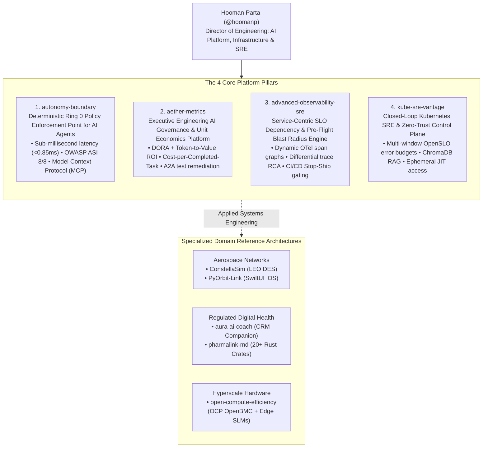

# Hooman Parta
### Director of Engineering | AI Systems, Hyperscale Infrastructure & Platform Reliability
**AI Inference Unit Economics • Provable Agent Governance • Closed-Loop SRE • Hyperscale Cloud Platforms**

---

## Executive Profile & Operating Scale

Engineering executive with 25+ years leading global platform, cloud infrastructure, and AI systems organizations at Fortune-100 and hyperscale scope. Track record of owning multi-year technology roadmaps, managing $40M+ capital and compute budgets, and leading global organizations of 50+ engineers across NA, EMEA, and APAC through 5 engineering managers.

### Verified Production Scale & Financial Impact
- **Real-Time AI Inference at Scale (`~1B Sessions/Month`):** Led platform engineering for an enterprise voice AI platform handling approximately one billion monthly sessions, executing the architectural transition from legacy RNN models to real-time LLM inference under a strict `< 100 ms` latency budget.
- **Inference Unit Economics (`~30% Cost Reduction`):** Architected complexity-based tiered model routing (routing high-volume deterministic intents to compact models and complex reasoning to frontier tiers with automated circuit-breaker fallbacks) and migrated self-hosted inference clusters to managed cloud AI services, reducing compute spend by ~30%.
- **Hyperscale Fleet Modernization (`10,000+ Nodes`):** Directed the migration of 10,000+ compute nodes to cloud-native Kubernetes architectures with automated multi-window OpenSLO error budget enforcement and zero-trust access boundaries.
- **Provable AI Governance (`Ring 0 Execution Kernel`):** Author of the open-source **Autonomy Boundary Framework (ABF)**, providing deterministic sub-millisecond (`< 0.85 ms`) policy enforcement and cryptographic non-repudiation for enterprise AI agents.

---

## Executive Metrics & Architecture Benchmarks

| Strategic Domain | Production Metric / Invariant | Architectural Implementation |
| :--- | :--- | :--- |
| **Enterprise AI Traffic Scale** | **`~1 Billion Sessions / Mo`** | Real-time voice AI inference platform operating under a `< 100 ms` end-to-end latency SLA |
| **Cloud & AI Unit Economics** | **`~30% TCO Reduction`** | Tiered complexity routing, prefix-cache optimization, and managed cloud inference consolidation |
| **Agentic Governance Latency** | **`< 0.85 ms` (Zero-LLM)** | Deterministic SHA-256 Policy Enforcement Point in [`autonomy-boundary`](https://github.com/hoomanp/autonomy-boundary) (8/8 OWASP ASI coverage) |
| **Engineering Org Velocity** | **`-24.8% Cycle Time`** | Closed-loop DORA + Token-to-Value governance and A2A test synthesis in [`aether-metrics`](https://github.com/hoomanp/aether-metrics) |
| **Pre-Flight Reliability Gating** | **`Stop-Ship on BRI`** | OpenTelemetry span-link dependency graph and Blast Radius Index in [`advanced-observability-sre`](https://github.com/hoomanp/advanced-observability-sre) |
| **Zero-Trust Remediations** | **`Ephemeral JIT Grants`** | Automated Kubernetes self-healing with scoped 60s OIDC tokens in [`kube-sre-vantage`](https://github.com/hoomanp/kube-sre-vantage) |

---

## Core Platform Architecture: The 4 Executive Pillars

---

## The 4 Primary Executive Repositories

### 1. [autonomy-boundary](https://github.com/hoomanp/autonomy-boundary): The Autonomy Boundary Framework (ABF)
* **Operational Problem:** Enterprise deployment of autonomous AI agents introduces severe execution risk when agents mutate production databases, execute shell commands, or trigger financial transactions based on probabilistic outputs vulnerable to prompt injection, approval divergence, or state drift.
* **Architectural Solution:** Operates as Ring 0 for AI Agents: a deterministic, sub-millisecond (`< 0.85 ms`), zero-LLM Policy Enforcement Point (PEP) and split-custody audit ledger. Neutralizes real-world agent vulnerability classes (SymJack approval divergence, DSEWiki scope gaps, stale state execution) across all 8 **OWASP Agentic Security Initiative (ASI)** categories. Includes native **Anthropic Model Context Protocol (MCP)** gateway enforcement.

### 2. [aether-metrics](https://github.com/hoomanp/aether-metrics): Engineering AI Governance & Unit Economics Platform
* **Operational Problem:** Engineering executives lack quantitative visibility into whether generative AI tools and production agent loops are reducing cycle time or inflating cloud bills through uncached token churn, suboptimal tier routing, and downstream review bottlenecks.
* **Architectural Solution:** An executive telemetry and governance control plane tracking **DORA + AI Unit Economics** (Cost-per-Completed-Task, Prefix Cache Hit Ratio, Cycle Time Delta, and Token-to-Value efficiency). Includes an **Agent-to-Agent (A2A) JSON-RPC orchestration runtime** that detects test coverage deficits on active pull requests and dispatches specialized subagents to synthesize unit tests before merge.

### 3. [advanced-observability-sre](https://github.com/hoomanp/advanced-observability-sre): Service-Centric SLO Dependency & Blast Radius Engine
* **Operational Problem:** Across thousands of microservices and multi-step AI inference pipelines, localized latency regressions or uncached context expansions cascade non-linearly into Tier-0 brownouts.
* **Architectural Solution:** An observability control plane using OpenTelemetry span links and context propagation to reconstruct real-time service dependency multigraphs. Computes a mathematical **Blast Radius Index ($BRI$)** inside canary deployment pipelines, enforcing automated **Stop-Ship halts** when projected degradation threatens Tier-0 error budgets.

### 4. [kube-sre-vantage](https://github.com/hoomanp/kube-sre-vantage): Closed-Loop Kubernetes SRE & Zero-Trust Control Plane
* **Operational Problem:** Static threshold alerting drives on-call fatigue, while automated self-healing operators often hold standing `cluster-admin` privileges that violate zero-trust security standards.
* **Architectural Solution:** A closed-loop reliability control plane across EKS, AKS, and GKE. Normalizes telemetry via OpenTelemetry, correlates incidents against ChromaDB vector memory of historical post-mortems and SLA contracts, decouples CPU control-plane orchestration from GPU inference pools, and executes remediations through a **Zero-Trust Just-In-Time (JIT) access broker** using short-lived, scoped tokens.

---

## Executive Thought Leadership & Publications

Creator of the LinkedIn engineering leadership series **What Changed This Month** and **The Autonomy Boundary**, analyzing production AI unit economics, infrastructure trade-offs, and deterministic agent governance:

1. **LLM Unit Economics & Prompt Caching:** *Why headline token list prices no longer dictate production AI bills: modeling prefix-cache reuse (61% task cost reduction), cache-write surcharges, TTL eviction boundaries, and complexity-based tier routing.*
2. **RAG Economics & Retrieval Precision:** *Evaluating the unit cost and recall degradation of 1M-token context windows versus hybrid vector retrieval, cross-encoder reranking, and abstention-trained models.*
3. **Eval-Driven Deployment & Stop-Ship Gates:** *Why static offline benchmarks fail in production: implementing synthetic canary evaluations, Blast Radius Index ($BRI$) gating, and Ring 0 execution boundaries.*
4. **Decoupling Agent Orchestration from GPU Inference:** *Unbundling I/O-bound agent tool loops onto elastic CPU nodes while isolating high-TCO GPU clusters strictly for forward passes and high-utilization MoE serving.*

---

## Specialized Domain Reference Architectures

In addition to core AI platform and cloud reliability engineering, I maintain reference architectures demonstrating systems engineering across regulated and mission-critical domains:

### Aerospace & Satellite Telecommunications
* **[ConstellaSim](https://github.com/hoomanp/ConstellaSim):** *LEO Satellite Network Topology & Discrete-Event Simulator:* SimPy + Rust hybrid core (`constella-core-rs`) discrete-event simulator modeling packet-level routing and dynamic Inter-Satellite Link (ISL) mesh topologies across LEO mega-constellations.
* **[PyOrbit-Link](https://github.com/hoomanp/PyOrbit-Link):** *LEO Ephemeris Tracker & Native SwiftUI iOS App:* Aerospace telecommunications toolkit integrating Skyfield SGP4 orbit propagation, relativistic Doppler shift tracking ($\pm 65\text{ kHz}$ at Ka-band), ITU-R P.618 rain fade budgeting, and a native **iOS 17+ flight companion app**.

### Regulated Life Sciences & Digital Health
* **[aura-ai-coach](https://github.com/hoomanp/aura-ai-coach):** *Cardiovascular CRM Implant Mobile Companion Platform:* Digital health reference architecture bridging cardiac telemetry with consumer health ecosystems (Apple HealthKit & Google Health Connect). Enforces **FDA FD&C Act §520(o)** general wellness boundaries, IEC 62304 Class A/B decoupling, MCP integration, and 130/130 passing automated tests.
* **[pharmalink-md](https://github.com/hoomanp/pharmalink-md):** *Dual-Product Healthcare Distribution Engine:* Monorepo of 20+ specialized Rust crates powering prescription routing and multi-tenant delivery logistics, backed by dual-region PostgreSQL 16 and aligned with HIPAA, PIPEDA, and Quebec Law 25 requirements.

### Hyperscale Hardware Operations
* **[open-compute-efficiency](https://github.com/hoomanp/open-compute-efficiency):** *Predictive Hardware Reliability & Fleet Health Control Plane:* Infrastructure framework ingesting OpenBMC Redfish telemetry on Open Compute Project (OCP) racks, running edge-quantized Small Language Models (SLMs) to predict component degradation (PCIe AER, DRAM ECC errors), and automating non-disruptive workload drains.

---

## Executive Leadership Scope & Technical Competencies

| Leadership Dimension | Scope, Governance & Technical Stack |
| :--- | :--- |
| **Organization & P&L Ownership** | Global Engineering Leadership (50+ engineers, 5 EMs across NA/EMEA/APAC), $40M+ Capital & Cloud Compute Budgets, Multi-Year Platform Roadmaps, Vendor Contract & Cloud Commit Negotiations. |
| **AI Platform & Unit Economics** | High-Throughput Real-Time Inference (~1B sessions/month, `<100ms` SLA), Tiered Model Routing & Circuit Breaking, Prompt Prefix-Cache Optimization, Deterministic Agent Governance (ABF / MCP). |
| **Hyperscale Cloud & SRE** | 10,000+ Node Fleet Migrations, Kubernetes (EKS, AKS, GKE), OpenTelemetry (OTel) Distributed Tracing, Multi-Window Multi-Burn-Rate Error Budgets (OpenSLO), Pre-Flight Blast Radius Simulation. |
| **Security & Regulatory Compliance** | **CISSP Certified**, Zero-Trust JIT Access Brokering, OWASP Agentic Security (ASI), FDA 21 CFR Part 11, HIPAA Security Rule, SOC2 Type II, PIPEDA & Quebec Law 25. |
| **Systems Programming & Runtimes** | **Python** (FastAPI, PyTorch, SimPy), **Rust** (Axum, Tokio, SQLx), **Go**, **Swift / SwiftUI**, TypeScript (Next.js, React Native), SQL (PostgreSQL 16, ClickHouse), C++. |

---

## Connect

- **LinkedIn:** [linkedin.com/in/hooman-parta](https://www.linkedin.com/in/hooman-parta)
- **GitHub:** [github.com/hoomanp](https://github.com/hoomanp)
- **Location:** Los Angeles, CA / Remote (Global Executive Scope)
